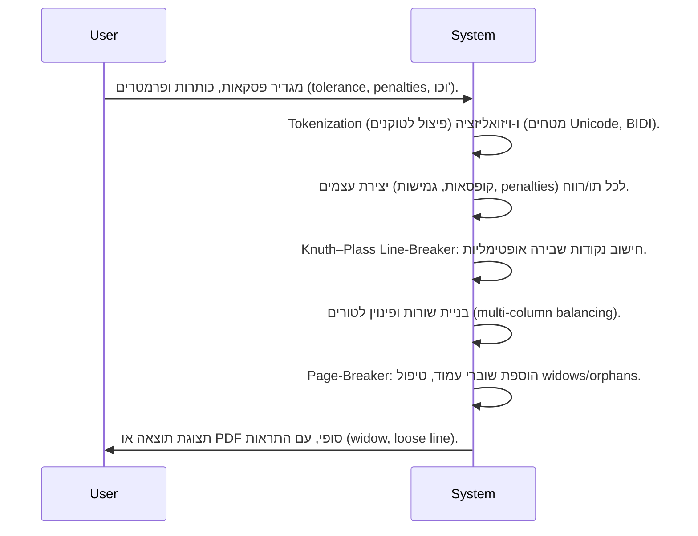

# סיכום מנהלים

אלגוריתם Knuth–Plass לשבירת טקסט הוא אלגוריתם אופטימלי ברמה עולמית לעימוד פסקאות: הוא מתייחס לפסקה כיחידה שלמה (ולא מקבל החלטות שורה-אחרי-שורה), ומציב את נקודות הפיצול כך שהעלות הכוללת – המכונה *de-merits*, הנגזרת ממידת שגיאת המילוי (badness) של כל שורה ועונשים נוספים – תהיה מינימלית. במילים אחרות, האלגוריתם מחשב לכל שורה מדד “badness” (תלות בהתאמת הריווח) וכן עונשים עבור מקרים בעיתיים (כגון שבירת מילה באמצע או ריווחים חריגים). לאחר מכן מוצא את סדרת נקודות השבירה שממזערת את סכום ריבועי ה-*badness* והעונשים. השיטה משתמשת בתכונות “קופסאות” ו-“גמישות” (glue) כדי לייצג תווים ורווחים, ו-“עונשים” כדי לציין מקומות שבירה אפשריים או כפויים. אופטימיזציית הדינמיקה (dynamic programming) מאפשרת למצוא פתרון עולמי בזמן פולינומי במקרה רגיל. מימושים שונים של אלגוריתם Knuth–Plass נמצאים במערכות כמו TeX、LuaTeX、ConTeXt ואפילו בתוכנות DTP מסחריות (למשל Adobe InDesign). בעימוד עברית תורנית יש צורך להתאים את האלגוריתם: יש לתמוך בהנחיית ימין-לשמאל (עיבוד BIDI), במילים ארוכות וללא היפנציה, בטקסטים תורניים עם ניקוד וטעמים, וכן בהתפלגות לטורים מרובים.

# עקרונות האלגוריתם והמודל

האלגוריתם מייצג פסקה כרצף של אובייקטים: תווים (קופסאות) ורווחים (גמישות) ונקודות שבירה (עונשים). לכל נקודת שבירה (או סוף פסקה) ניתן “לעצור” שורה. אם אורך השורה שונה מהרוחב הרצוי, נוצר יחס *הרג'ולציה* \(r_j\) (יחס השינוי ביחס לגמישות הכוללת), וממנו חושב מדד **badness** לבטא את “שגיאת הריווח” של שורה j. Knuth-Plass מגדיר את ה-badness כך שהוא קטנטן עבור \(r_j\) קרוב ל-0, וגדל במהירות עבור ערכים גדולים יותר. בפועל:

- אם \(r_j < -1\) (היינו, דרושה דחיסה יתרה מעבר לכושר ההידוק המירבי), קובעים שמדד ה-badness אינסופי (מותר לפרש כ-10000) – כלומר, מקרה זה אינו אפשרי ממהה.
- אחרת המדד מוגדר כ־\((100|r_j|)^3\). כלומר, מגדילים את \(|r_j|\) פי 100 ולוקחים קובייה. כך שורות מעט צרות או רחבות לא נדחות בקלות, אך שינויים גדולים מאוד מתומחרים בחומרה.

בנוסף, האלגוריתם מוסיף **עונשים (penalties)** במקומות של שבירת מילה (ולעתים יוסיף ‘עונש מודגש’ flag) או עבור אירועים לא רצויים (למשל שבירת שתיים ברצף באמצע שתי מילים). לדוגמה, \(\text{penalty}=50\) עבור היפנציה מקובלת, \(-10000\) לכפיית שבירה (כמו `\hfill`), וכדומה.

לאחר שווים מבצעים חשבון badness לכל שורה אפשרית, האלגוריתם מחפש את *סדרת נקודות השבירה שיש בה את סכום הדמראיות (badness+penalties לכל שורה) המינימלי*. סכום הדמראיות לכל אפשרות שורה \(j\) הוא למעשה פונקציה של ה-badness \(p_j\) והעונש \(n_j\) של אותה שורה. Knuth-Plass מציע בחיבורו להשתמש בפונקציה כמו:

\[
S_j = 
\begin{cases}
 (1 + p_j + n_j)^2 + a_j, & n_j \ge 0,\\
 (1 + p_j)^2 - n_j^2 + a_j, & n_j < 0\;\text{(ולא}=-\infty),\\
 (1 + p_j)^2 + a_j, & n_j = -\infty\;\text{(כפוי)}.
\end{cases}
\]

כאן \(a_j\) הוא “עונש נוסף” הנוסף אם גם השורה הקודמת וגם הנוכחית מסתיימות בדגל שבירה (למנוע היפנציה בשתיים ברצף). הנוסחה הזו (ריבוע של \(1+p_j+n_j\) או \(1+p_j\)) נבחרה כדי שהפתרון הכולל יצמצם את סכום ריבועי ה-badness, מה שמוביל לאיזון טוב בין שורות קשות ושימוש בתכונות אופטימיזציה משניות.

כדי למצוא את הרצף האופטימלי, האלגוריתם משתמש בתכנות דינמי: הוא עובר על כל נקודות השבירה האפשריות בפסקה, ומחשב לכל “צומת פעיל” (active node) – המייצג שורה אפשרית – את עלות המעבר לנקודות שבירה הבאות. בסופו של התהליך בוחרים בנתיב עם סך הדמראיות המינימלי. כך מתאפשר פתרון בזמן סביר (כמעט \(O(n^2)\) או \(O(nw)\) בזמן סביר, לפי ניתוח דינמי) במקום חיפוש אקספוננציאלי של כל הצירופים.

```mermaid
flowchart LR
    A[טקסט מקור] -->|Tokenization ו-Shaping BIDI| B[פסקה משורטטת (RTL/LTR)];
    B -->|Knuth–Plass (boxes/glue/penalties)| C[יצירת שורות];
    C -->|חישוב עמודות ושקלול| D[טור/עמוד];
    D -->|יישור עמודים/איזון| E[עימוד סופי ל-PDF/דפס];
```

בפועל, בשגרה של מערכות כמו TeX או LuaTeX, כל הפסקה עוברת ל-*par builder* שמיישם את Knuth-Plass, ומקבל קלט של אובייקטים (קופסאות תווים, רווחי גמישות, נקודות שבירה). התוצאה היא רשימת שורות ולחיצות בכל שורה. שורות אלו מתורגמות אחר-כך לפריסה בטורים, ובאופן דומה ניתן לבצע עימוד למספר טורים או עמודים תוך תיקוני איזון נוספים. 

# פרמטרים מרכזיים 

באלגוריתם Knuth–Plass מוגדרים מספר **פרמטרים הניתנים לכוונון** המשפיעים על הפתרון:

- **Tolerance** (סובלנות, נסמן \(p\)) – הגבול העליון של יחס ההתאמה \(r_j\). האלגוריתם לא יאפשר ערכים מוגזמים: כל יחס \(|r_j|>p\) ייחשב לא-ניתן (כך שבפועל כל שורה חייבת להיות עם \(-1 \le r_j \le p\)). בקונטקסט של TeX, פרמטר זה מתורגם ל־`\tolerance` (ברירת מחדל ≈200), וגורם לסף של “שורות בעייתיות” (badness גבוהות) שיאושרו. ערך נמוך ייתן ריווח מדויק יותר אך עשוי לדרוש היפנציה או הרפיית מספר השורות.

- **Looseness** (\(q\)) – הפרש קוּלי מירבי (או חסר) במספר השורות ביחס לפתרון האופטימלי. אם \(q=0\) האלגוריתם ינסה בדיוק את מספר השורות האופטימלי; אם \(q>0\), ינסה פתרון עם \(q\) שורות **יותר** מהאופטימום; אם \(q<0\), עם \(|q|\) שורות **פחות**. האלגוריתם משנה את היעד בהדרגה עד שמתקבל פתרון אפשרי. ב-TeX הפרמטר מקושר לפקודת `\looseness`. השימוש ב-\(q\) מאפשר, למשל, להאריך שורה כדי להימנע מקוית יתום (widow) או לגרוע שורה כדי להשוות בין טורים.

- **Penalty Parameters** – מערך של ערכי עונש לקטגוריות שונות. לדוגמה, עונש גבוהה (\(10000\)) אומר “אסור לשבור כאן”, ערך נמוך (למשל \(-10000\)) אומר “כפה שבירה”, ואמצעי (\(~50\)) אומר “אפשרי אך יקר”. TeX מציב `\hyphenpenalty`, `\exhyphenpenalty`, `\brokenpenalty`, `\clubpenalty`, `\widowpenalty` וכו'. בפרויקטים תורניים ממולץ להגביה (\(\text{10000}\)) את \(\clubpenalty\) ו-\(\widowpenalty\) כדי למנוע שורה יתומה, וכן להשתמש ב-\(\pretolerance\) ו-\(\emergencystretch\) במידת הצורך.

- **דמראיות נוספות** – ערך נוסף \(a_j\) שמוסיף עונש אם שורות עוקבות מסתיימות בו-זמנית בהיפנציה (כלומר דגל שבר במילה). במילים אחרות, הימנעות מהיפנציה בשתי שורות רצופות. הפרמטר \(c\) מתווסף לציון הדמראיות עבור מצב זה, וכך מעודד פיזור ההיפנציה לאורך הפסקה.

- **Fitness classes** – האלגוריתם מחלק את השורות ל-4 קטגוריות לפי \(r_j\): קוּם *tight* (class 0: \(-1<r<-0.5\)), *normal* (class 1: \(-0.5\le r\le 0.5\)), *loose* (class 2: \(0.5<r<1\)) ו-*very loose* (class 3: \(r\ge 1\)). אם שתי שורות עוקבות הן בקטגוריות *בלתי-תואמות* (למשל class 0 אחרי class 2/3, או class 1 אחרי class 3), האלגוריתם מוסיף דמראיות נוספת כדי להימנע מניגוד חמור בין ריווחים. קביעת קטגוריה זו מאפשרת “ניקוי סף” חזותי: למשל להקשות על מעבר משורה מאוד הדוקה לשורה מאוד רחבה.

כל הפרמטרים הנ״ל ניתנים לכוונון לפי סוג הטקסט. בטקסט לימודי או מסחרי רגיל עשויים להשתמש בערכי ברירת מחדל צפויים (\(\tolerance\approx200\), \(q=0\), עונשי \(\widow=\club=150\) ב־TeX המסורתי), ואילו בספרי קודש או תפילה ייתכן שיבחרו במדיניות מחמירה יותר (למשל \(\tolerance\) נמוך מאוד, \(\clubpenalty=\widowpenalty=10000\), \(\looseness=0\)) כדי לשמור על עימוד “שמור”. במצבי טקסט מעורב (ציטוטים, קוד) ייתכן שיהיה צורך בהרפיית ריווח (\(\tolerance\) גבוה יותר) כדי להתאים לפורמטים מגוונים, או בהתאמה פרטנית לעמודי תוכן מיוחדים.  

| קונטקסט            | \(\tolerance\) מומלץ   | \(\looseness\)    | \(\clubpenalty\) | \(\widowpenalty\) | הערות נוספות          |
|--------------------|-----------------------|-----------------|-----------------|------------------|-----------------------|
| ספר לימוד כללי     | 200–300 (בינוני)      | 0 (אופטימלי)    | ≈150           | ≈150            | אפשרי היפנציה; hyphenpenalty רגיל |
| ספר תפילה/קודש    | נמוך (50–100)         | 0               | 10000          | 10000           | אין היפנציה בכלל; הדגשת מצב אונסידי (אילן ועוד) |
| טקסט עם ציטוטים/קוד | גבוה (500–1000)      | 0–1            | 1000–10000     | 1000–10000     | ויתור על איזון מלא; שורות תגובות מיוחדות |
| *ללא כוונון*      | **200** (ברירת מחדל) | **0**           | **150**         | **150**          | ערכי ברירת מחדל של TeX |

# התאמות לטקסט עברי/תורני

**הנחיית ימין-לשמאל (RTL):** האלגוריתם עצמו אינו תלוי בכיוון (ניתן להתייחס אליו על רצף סימטרי של קופסאות). עם זאת, בטקסטים עבריים יש צורך קודם בביצוע אלגוריתם Unicode-BIDI כדי לעצב מחדש את הפסקה (כמו TeX עם \RL). במערכת מודרנית ההנחיה נעשית בשלב **tokenization/shaping**: מזיזים ומסדרים את התווים כך שהם יורכבו נכון מימין לשמאל, ואז מפעילים את Knuth–Plass על התוצאה. במילים אחרות, האלגוריתם מתבצע על *המבנה הלוגי* של הפסקה לאחר עיבוד BIDI. פרימטרים כמו גדלים שונים של אותיות או שבירת גרשיים מוטיבית, יטופלו גם הם בשלב העיבוד הראשוני.

**מילים ארוכות וניקוד:** בעברית תורנית נפוצים מילים ארוכות מאוד (פלגמנטים, שמות קדושים, ביטויים ארוכי תו). מכיוון שאין היפנציה מקובלת בלעז (והטעמים והניקוד בעייתיים ל־TeX), אין כמעט שבירות באמצע המילים הקדושות. לכן עדיף להימנע מהיפנציה – או להגדיר עונש גבוה במיוחד (`\hyphenpenalty=10000`) למקרה של שבירת מילה עברית. ניתן לאפשר שבירה מינימלית בנקודות הגיוניות (כגון באמצע שמות ארוכים פחות קדושים). בנוסף, מערכת TypesetOK המצוטטת משתמשת ב-*אהלתר"ם* – שיטת הרחבת אותיות מפוצלות מסורתית – כדי להתגבר על מקומות שבהם המילה ארוכה מדי. כלומר, ניתן להשתמש בנירמול ויזואלי של אותיות (לדוגמה הרחבת אלף/תיו או שימוש ב־micro-tracking של עד 2%) כדי למלא רווחים גדולים בלי להוסיף היפנציה. כמו כן יש לוודא שהקופסאות מייצגות נכון את הניקוד/טעמים (ב־TeX הם מאופיינים כבייטים מופיעים כסמיכות לאות), כך שהתחום הכולל של כל מילה ייקבע לפי מספר התווים הכולל (אותות + ניקוד).

**טקסט משולב (עברית/ארמית/לטינית):** במקרה של מעבר שפה בתוך הפסקה, נהוג להפריד בין תבניות עימוד שונות. למשל, פסוק בעברית בתוך עמודו של פירוש – צריך ללכד אותו כשורה משלו. ניתן להגדיר שיש שני מנגנוני שבירה נפרדים או להשתמש במפרידי אובייקטים עם תכונות שונות (כגון הבדלי רחב־קופסאות). במערכת עימוד תורנית יכולה להיות הגדרה שמקצה לכל הבלוקים העבריים את אותה הגדרה (כמו שיטת עימוד אחידה), ומאפשרת ל-TeX או למנוע השבירה לזהות היכן השפה משתנה ולהתאים לפי need.

**היפנציה (או היעדרה):** בעברית קלאסית ובעיצוב קודש, היפנציה נדירה או אסורה. ברוב מערכות היישום נהוג להשבית לחלוטין את היפנציה בעברית; אם מוסיפים היפנציה (למשל בגיליונות מודרניים או טקסטים אקדמיים), עושים זאת בזהירות רבה. בטקסט תנ"כי/גמראי אין להכניס הקשים באמצע מילים קדושות (כדאי לאפשר היפנציה רק לאחר תיבות נפוצות ולא בתוך שמות). לעומת זאת, עבור תוכן לועזי בקירוב (ציטוטים באנגלית או קוד), ניתן להשתמש באלגוריתם פטרנים סטנדרטי (Liang) כפי ש-TeX עושה, ולקבוע מינימום תווים בצד שמאל/ימין (`\lefthyphenmin`, `\righthyphenmin`). הכוונה היא שאם כלל מתרפא, הוא יגרום לדמראיות גבוהה (בעייתי) משום שבכל מקרה שורות אלו יהיו קרובות לגבול הטולרנס.

# פרקטיקה במערכת עימוד מודרנית

במערכת מודרנית לעימוד ספרים תורניים רצוי לארגן את תהליך העיבוד לשלבים ברורים, כפי שמוצע בשרטוט הבא:



עבור השלב של שבירת שורות, המערכת צריכה לקבל כקלט מבנה נתונים של פסקה מפורקת למרכיביה: כל מילה/תו כרצף קופסאות, כל רווח כגמישות עם אורך מינימלי, אידיאלי ומקסימלי, וכל נקודת שבירה אפשרית עם ערך עונש מתאים. ניתן לשמור למשל מערך של *KnuthBoxes* (תווים) ו-*KnuthGlue* (רווחים), כפי ש-TeX עושה בפנימי. השלב הבא מציב על האלגוריתם את הפרמטרים (tolerance \(p\), looseness \(q\), penalties ועוד) ומפעיל את דינמיקת התכנות. את רצף נקודות השבירה האופטימלי מחזירים כסדרה של breakpoints, ממנה מרכיבים רשימת שורות.

במערכת תורנית מרובת טורים, יש שני שלבים עיקריים: *יוצר השורות* ופיזורן בטורים, ואז *איזון הטורים*. אפשר לבצע זאת כך: מריצים את Knuth–Plass על כל פסקה כרגיל (לרוחב כל טור בנפרד). אחרי שהטורים מלאים, בודקים את הפרש הגבהים ביניהם. אם ההפרש גדול מדי, נפעיל מנהל איזון: למשל, נחזיר לעיבוד את פסקאות קצה העמוד (מהטור הגבוה יותר) עם שינוי \(\looseness\) שיאפשר קצת יותר או פחות שורות כדי להשוות. ריצוף נוסף יכול לשפר איזון עמוד. ניתן גם להרחיב בפועל את הרווחים בטור הקצר יותר (לדוגמה, קצת \(\emergencystretch\) או letter-spacing).

**אינטגרציה של כותרות/כותרות משנה:** כותרת ראשית או משנה משולבת בתוך תהליך העימוד יכולה לחרוג מהשימוש בטורים קבועים. יש שני מקרים: אם כותרת בודדת אמורה לכסות את רוחב העמוד (לדוגמה כותרת דף באמצע עמוד דו-טורי), רצוי להפסיק לפני הכותרת, לרוץ פעם נוספת את Knuth–Plass על רוחב מלא עבור הכותרת, ואז לחזור לחלוקת טורים מתחתיה. לעומת זאת, כותרות קצרות יותר שיתפסו טור יחיד באמצע העמוד הדו-טורי יטופלו כאילו הן חלק מהזרימה הרגילה, אך ניתן להציב עונש גבוה לפיצול שורות סביבן (למשל לאפשר מינימום שתי שורות טקסט אחרי כותרת), כדי להבטיח שיש טקסט ממשיך ולא כותרת “יתומה” בתחתית טור.

**מודעות לבעיות נפוצות:** במהלך העימוד יש לעקוב אחר מקרים בעייתיים ולעדכן פרמטרים או להפעיל עיבוד משלימים. לדוגמה:
- *טורים לא מאוזנים:* אם בתוך עמוד דו-טורי נוצר פרש גובה גדול, יש לבחון הגברת סובלנות (`tolerance`) בפסקאות קרובות לפסגה של הטור הארוך או להפחיתה לטור הקצר. לחלופין, ניתן לשנות `\looseness` של פסקה מסוימת בכדי לשנות קוּל השורות.
- *שורה דלילה בסוף פסקה:* אם הפסקה נחתמת בשורה עם רק מילה אחת או שתיים (ולכן מרווחיה גדולים מאוד), עדיף לנסות “לדלל” את הפסקה: להגדיל את `\looseness` בכיוון הגורם לשורה אחת נוספת (או להחזיר שורה ולגרום להצטמצם). אם זה לא מסתדר, אפשר לשנות את `\tolerance` או להוסיף `\penalty` מיוחד לפני סוף הפסקה כדי לאלץ פיצול מוקדם יותר.
- *שורות יתומות/אלמנות:* יש לשים לב למקרים שבהם השורה העליונה של פסקה חדשה מתחילה בעמוד (או טור) כשהפסקה הקודמת הסתיימה בעמוד הקודם; במקרה כזה אפשר להכניס `\widowpenalty` גבוה כדי לא לאפשר שתי שורות נפרדות. דומה לכך, שורה אחרונה “יתומה” (או מעט מילה בפסגה העמוד) לא רצויה – משתמשים ב־`\clubpenalty`. בטורים מרובי-עמודים נהוג להחיל את אותו כלל לכל טור כאילו הוא עמוד בפני עצמו (כלומר שורה אחת בראש טור חדש נחשבת כיתומה, ובסופו של טור כאלמנה). התראות על בעיות widows/orphans כדאי להציג לעורך (לדוגמה בכיתוב אדום ליד העמוד).
- *כותרת בתחתית טור:* אם הגיעה כותרת לסוף טור בלי הטקסט הרצוי אחריה, עדיף להעבירה לטור הבא. ניתן למשל להוסיף לפני הכותרת `\penalty=10000` או להגדיר בשורת סגנון “אין להותיר כותרת בטור ללא לפחות שתי שורות מתחת”. מנגנון זה מונע כותרות ‘יתומות’.
- *כותרת בטור יחיד באמצע עמוד:* כפי שצוין, יש לטפל בזה כמקטע נפרד. אפשר להזין העברה יזומה (`\pagebreak`) לפני הכותרת, ליישר אותה לרוחב ושוב לעמוד לשני טורים אחריה.

במקרים אלה מומלץ להטמיע מנגנוני *ניפוי שגיאות*: למשל, לאחר ריצת העימוד לבצע סריקה לזהות widows ו־“שורות רופפות”, ולהציג אזהרה או הרשאת תיקון אוטומטי. עורכי ספרים תורניים יכולים לקבל ממשק משתמש עם סליידרים לכיוון `\tolerance`, `\looseness`, טיפול בהיפנציה (הדלק/כבה), והצגת פרטי “דירוג” שורות (tight/loose), בדומה לתוכנות וידאו שעוקבות אחרי מצבים בעייתיים.

# דוגמאות וקוד (פְּסוֹדוֹקּוֹד)

```python
def knuth_plass_line_break(tokens, widths, stretch, shrink, tolerance, looseness, penalties):
    # tokens: רשימת קופסאות/גמישות עם אורך איפי+stretch+shrink
    # צרכי compute summations מראש
    n = len(tokens)
    active_nodes = [Node(position=0, line=0, fitness=1, total_demerits=0)]
    best_break = None

    for b in range(1, n+1):
        if not is_breakpoint(tokens[b-1]): continue
        new_active = []
        for a in active_nodes:
            (L_ab, Y_ab, Z_ab) = line_metrics(a.position, b, widths, stretch, shrink)
            r = compute_adjust_ratio(L_ab, Y_ab, Z_ab)  # (אורך אדפטציה)
            if r < -1: 
                continue  # לא חוקי, לכתוב מחדש
            if r <= tolerance:
                p = badness(r)   # (100*|r|)^3
                n_penalty = penalties.get(b-1, 0)
                S = compute_demerits(p, n_penalty, a.fitness, next_fitness(r), penalties['adjacent_class'])
                new_node = Node(position=b, line=a.line+1,
                                fitness=next_fitness(r),
                                total_demerits=a.total_demerits+S,
                                prev=a)
                new_active.append(new_node)
        # נשמור רק המועמדים הטובים ביותר בכל מיקום חדש
        active_nodes = select_best_nodes(new_active)
    # נבחר צומת עם demits מינימלי המתאים ל-looseness
    end_node = pick_node_by_looseness(active_nodes, target_lines=len(active_nodes)+looseness)
    return backtrack_breaks(end_node)
```

הפסקה לעיל ממחישה בפסבדוקוד את מבנה אלגוריתם ה־DP: רשימת “צמתים פעילים” (active nodes) עוברת פסקה ומשווה נקודות שבירה. בכל סוף שורה (b) היא בוחרת מבין הצמתים הקיימים מי יכול לעבור לכאן (אם `-1 ≤ r ≤ p`), מחשבת את demits של כל מעבר, ומשמרת את הטובים ביותר לפי כל `fitness` ו-`line count`. לבסוף בוחרים את הנתיב עם demits המינימלי שמקיים את דרישת `looseness`. בשפות מודרניות ניתן ליישם זאת ב-C, Python, Rust, או אפילו ב-Emacs Lisp (קיימת דוגמה פתוחה ב־[Emacs-KP](https://github.com/Kinneyzhang/emacs-kp){target="_blank"} המיישמת את Knuth-Plass עם תמיכה מלאה ב־CJK והיפנציה מסוג Liang).

# כלים וספריות

עבור שילוב מעשי במערכת, ניתן להשתמש בכלים קיימים:
- **TeX Live (pdfTeX, XeTeX, LuaTeX):** כולן מכילות מימוש מקורי לאלגוריתם זה (LuaTeX ניתנת כתיבת לוגיקה בשפת Lua). נשענות על Hyphen 패턴 אוטומטי ותומכות בפרמטרים כמו `\tolerance`, `\looseness`, `\widowpenalty` וכדומה.
- **ConTeXt & Metafun:** יש להם מנגנונים פנימיים ל-line breaking (ע׳י MathPar או MPW) בשילוב Lua או פוסט-פרוססינג.
- **Emacs-KP:** הרחבת Emacs חינמית המיישמת עימוד Knuth-Plass במלואו – כולל תמיכה מעולה ב-CJK והיפנציה על-ידי Frank Liang, כך שניתן לבדוק או לערוך פסקאות דרך עורכי טקסט.
- **TypesetOK (Rust):** פרויקט קוד-פתוח חדש לעימוד עברית מקצועית (כולל דפי גמרא) שבונה מנוע עימוד מלא ב-Rust. מצוין כתשתית התואמת תקן ת"י 6100, עם התממשקות מלאה ל־Knuth-Plass ול"אהלתר\"ם".
- **ספריות חיצוניות:** ניתן למצוא גם מימושים ב־JavaScript (למשל [Kadetr/paragraf](https://kadetr.github.io/paragraf/){target="_blank"} – ערכת עימוד דוממית של Knuth-Plass עם ריווח פיקסלים), ב־Python (חבילות דוגמת [python-knuth-plass](https://pypi.org/project/knuth-plass/) או שימוש ב־TeX כתשתית), וב־C/C++. 
- **פורמט פלט:** עם דפי PDF מתקדם (PDF/X, Unicode) לקבלת תוצאת דפוס מדויקת. לדוגמה, TypeOK תומכת ב-PDF/X-1a בעל 100% K שחור ובליד 3 מ"מ.

באופן כללי מומלץ לבחון מה המערכת הנוכחית שלכם (XeTeX, ConTeXt, וכו׳) ועד אם ניתן להטמיע את המנגנון בקלות. אם רוצים ממשק משתמש לעריכת פרמטרים, כדאי להציג את ה־tolerance והתוצאות הצמודות (לדוגמה, לשנות `\tolerance` במסך בתצוגה חיה) ולהתריע על widows/orphans או שורות מאוד דלילות. 

# סיכום

סיכומו של דבר, מנוע Knuth–Plass מאפשר עימוד אופטימלי תוך כמות גדולה של כוונון. עימוד עברית תורני דורש הסתגלויות (RTL, טעמים, מילים ארוכות) ושילוב מדיניות אחידה. הטמעתו במערכת מודרנית עוברת במסלולי עיבוד מובחנים: הטקסט מתורגם לאובייקטים גראפיים (קופסאות/גמישות), האלגוריתם מחזיר שורות, והמערכת מדרגת/מאוזנת טורים. בעיות מיוחדות (טורים לא מאוזנים, שורות יתומות, כותרות בודדות) נפתרות על ידי הוספת עונשים ובדיקות post-processing, ובמידת הצורך על-ידי שינויים ידניים בפרמטרים (כגון `\looseness` או `\penalty`). המלצות הפרמטרים וההגדרות מסכמות ניסיון מעשי (ראו הטבלה), אך ניתן לכוון אותן לפי הצורך. לעורכים מומלץ להשתמש בכלי תצוגה דינמיים המצביעים על נושאי widows/orphans, ולספק ממשק לשינוי מדיניות העימוד (סליידרים לערכי tolerance, בדיקת hyphenation). עם שילוב נכון של Knuth–Plass ופתרונות משלימים (letter-spacing, פסקאות מוקטבות וכו'), ניתן להשיג עימוד עברי אחיד ויפה, גם בספרי הקודש התובעניים ביותר.

**מקורות:** המחקר המקורי של Knuth ו-Plass (1981) מתאר בפירוט את האלגוריתם. פרטים וסקירות נוספים מופיעים ב־*TUGboat* ובויקיפדיה של TeX. לפרמטרים ושיטות עדכניות נבחנו מאמרים וכלים מודרניים (e-TeX, LuaTeX) ופתרונות קוד-פתוח כגון *TypesetOK* ו-*Emacs-KP*. (התוכן המובא לעיל משלב פרטים טכניים מהמקורות הראשוניים עם המלצות פרקטיות מהספרות המקצועית.)