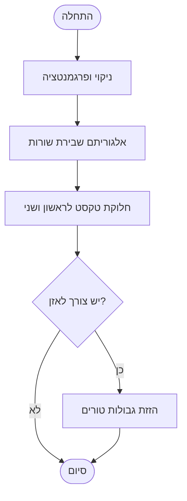

# עיצוב דו־טורי (דו־עמודי) בטקסטים עבריים ו־RTL: אלגוריתמים ויישומים

## תקציר מנהלים  
עימוד טקסט דו־טורי (דו־עמודי) בכתיבה עברית וב־RTL דורש שילוב של אלגוריתמי פיצול שורות ואלגוריתמי חלוקת טורים. בין האלגוריתמים הקלאסיים הבולטים: אלגוריתם Knuth–Plass לשבירת שורות גמישה (במערכת TeX) המחשבת נקודות שבר אופטימליות בדינמיקה ותומכת באיזון אורכי שורות. שיטות פשוטות יותר כוללות אלגוריתמים גרידיים או חלוקה גסה למחצה, וכן שיטות פירוק בעזרת תכנות דינמי למציאת נקודת פיצול האיזון המיטבית. במערכות מודרניות משתמשים גם בהליכים מרובי מעבר (multi-pass): חלוקה התחלתית על פי גובה משוער ולאחר מכן כיוונון נקודות השבירה לצמצום פערי גובה. 

כלים נפוצים כוללים **TeX/Latex** (מציע `_twocolumn_` ו־`multicol` ופקודות כמו `\balance` או חבילות כמו *flushend* למילוי שווה של הטורים); **InDesign** (מגיעה עם תמיכה מובנית ב־RTL ובאיזון טורים אוטומטי עבור מסגרות טקסט); **CSS/HTML** (מאפשרת ריבוי טורים באמצעות `column-count`, `column-fill: balance/auto` וכד’); ו**ספריות JavaScript** שמנסות לחקות זה בעזרת חישובי גובה מדויקים.

מקרי קצה חשובים הם **אלמנות ויתומים** (widows/orphans) – יש להימנע משורה בודדת מעל או מתחת לעמוד/טור. ב־TeX שולטים בזה באמצעות `\clubpenalty` ו־`\widowpenalty`, ב־CSS קיימים המאפיינים `orphans` ו־`widows` במודול דפי המדיה, ובחלק מהכלים יש אפשרות להוסיף ריווח בכפייה. יש גם לטפל ב-*שורות דלילות* (פיסקה עם מילה/שורה בודדת) באורך הטור, לדוגמה באמצעות הגדרת ערכי *להקות* (stretch/shrink) בטקסט או באמצעות שיבוץ תוספות כמו הפסקות שורות ידניות במידת הצורך. 

למערכות עם טקסט תורני (כתבי קודש) ישנם צרכים מיוחדים: עומקים (כמו צורות עליונות/תחתונות), מילים מקודדות, והפרדת פסוקים וסעיפים. לדוגמה, בפסוקים פורמט אקרוסטיכון או בכתב ספרדי יש לשמור על מבנה חזותי (כמו סימוני האל"ף־בי"ת בשיר המעלות) ופרגמנטים. ברוב המקרים יספיקו הכלים הכלליים, אך יתכן צורך בהתאמת התכנות או מאקרו בהתאם.

כדי לאתר פערי גובה בין טורים משתמשים במטודות מדידה ולבסס חלוקת תוכן כך שסך הגובה בכל טור מותאם (עץ סכימה או תכנון גָּרֵף). במקרים מסוימים הרעיון הוא לפתור בעיית **חציית פיסקה** (כלומר, איפה להפסיק עמודה כדי לאזן גובה). לדוגמה, בשיטת תכנות דינמי נשקלל עבור כל נקודת פיצול אפשרית עלות איזון כמותית ונבחר באופטימום. להלן פסאודו־קוד בסיסי להמחשה:

```plaintext
# חלוקת פסקאות לשני טורים באופן מאוזן (פשטני)
function balance_columns(paragraphs):
    total_height = sum(height(p) for each p in paragraphs)
    best_diff = infinity
    best_split = 0
    for i from 0 to len(paragraphs):
        height_left = sum(height(p) for p in paragraphs[0:i])
        height_right = total_height - height_left
        diff = abs(height_left - height_right)
        if diff < best_diff:
            best_diff = diff
            best_split = i
    return (paragraphs[0:best_split], paragraphs[best_split:])
```

ברשתות ובכלי ווב חדשים קיימות גם גישות חכמות: לדוגמה התכונה החדשה **`text-wrap: balance;`** ב־CSS (בעיקר לכותרות) מאזנת את אורך השורות באמצעות חיפוש בינארי בעובי הטור. פתרונות אלה מתאימים לכותרות קצרים אבל עדיין מוגבלים (ויש להם מגבלה של עד 6 שורות ב־Chrome כדי לשמור על ביצועים).

## אלגוריתמים קלאסיים ומודרניים

- **Knuth–Plass (TeX)** – אלגוריתם דינמי מפורסם לשבירת שורות באופטימום גלובלי. נחשב בסיבוכיות \(O(n^2)\) בגסיסה (אם בוחנים כל נקודת שבירה אפשרית), אך בעל אופטימיזציות המפחיתות את סיבוכיות הממוצעת על ידי פסילה מוקדמת של שבירות בלתי סבירות. האלגוריתם מקבל ריבוי פרמטרים (כמו משקל רווח מותר, עונשים על שאריות) ומוחל על פסקאות של טקסט. בסיום מתקבל פירוק לשורות שמצמצם את מעברי השורה החתומים (rivers) ומאזן את הריווח בין השורות.
- **Greedy** – חלוקה פשוטה של התוכן: דוחסים מילים עד שגובה הטור מגיע לקריטריון מסוים (למשל 50% מהטקסט) ואז עוברים לטור הבא. פשטני ומהיר (\(O(n)\)), אך עלול להשאיר פערים גדולים בין הטורים במקרה של פסקאות ארוכות ולא ניתן לשלוט ביעילות על אלמנות ויתומים. דוגמה: בפיסקה בעלת \(H\) גובה, נחצה לשניים בגובה \(\approx H/2\).
- **תכנות דינמי (פיסקה)** – דומה ל־Knuth–Plass, אך על רמת פסקאות/טורים במקום מילים/שורות. מחשבים עלות איזון לטור משמאל וימין על ידי בחינת כל נקודת שבירה אפשרית (מקוטע של פסקאות), ומחזירים את הפיצול עם העלות (הפרש הגבהים) הקטן ביותר. היתרון: תוצאה אופטימלית (בהינתן פונקציית עלות), החיסרון: סיבוכיות \(O(N^2)\) במספר הפסקאות ואף יותר (על פי הצורך למדוד גבהים).
- **אלגוריתמים מרובי מעבר (Multi-pass)** – מתבצע חלוקה ראשונית לפי גובה משוער (למשל על ידי חישוב ממוצע קוּסֵתוֹת כל פסקה וחלוקה גסה), ואז בתכנון שני עוברים למעלה/למטה בעמודה אחת כדי להצמיד את הגובה. למשל, אם אחרי החלוקה הראשונית הימני עוד 5 שורות נוספות לעומת השמאלי, מעבירים פסקאות או שורות מהימני לשמאלי וכך הלאה. ניתן גם לנסות *Spreading/Shrinking*: להכפיף את המרווח בין שורות (glue) לערכים משתנים (spread/shrink) עד לקבלת איזון מוגבל, כפי שמבצעים ב-*flushend*. חבילות עימוד מתקדמות (כמו flushend) מספקות אפשרויות *spread/shrink* במרכז הטורים והגבלת *badness* (דרגת החריגה).
- **רשתות ובניית עמודים (Paging/Virtualization)** – בממשקים מודרניים, במיוחד בדפדפנים, נדרשים לעתים מבנה וירטואלי של דפים. קיימים כלים כמו [Paged.js], [Prince], [Epub.js] המנסים לבצע עימוד כמו ספר מודפס בדפדפן. הם משתמשים בהנדסת DOM וחישוב דינמי של גובה האלמנטים. בשל קושי למדוד באופן מדויק גובה של טקסט במגוון פונטים ודפדפנים (כפי שהסביר [53†L239-L247]), האלגוריתמים המוטמעים בדפדפנים עצמם (כגון Flexbox או CSS Multi-column) לעתים מעדיפים להשתמש בחישוב פנימי או במקדמי פשרה (כמו התאמת `column-fill`) מאשר לחשב בשפת התכנות עצמה.

## השוואה בין פתרונות (טבלאות)

להלן השוואה תמציתית בין כלים ואלגוריתמים מרכזיים:

| פתרון / אלגוריתם       | איזון טורים                 | מורכבות (נעילה)        | תמיכה RTL              | בקרה על אלמנות/יתומים | יתרונות עיקריים              | חסרונות עיקריים         |
|-----------------------|----------------------------|------------------------|-----------------------|------------------------|-------------------------------|---------------------------|
| **Greedy**            | חלוקה גסה (לא תמיד מאזנת) | \(O(n)\) בפועל          | בלתי תלוי במשיכה          | ללא מנגנון ייעודי      | מהיר ופשוט                   | פערים גדולים, אינו אופטימלי |
| **DP פשוט (פרגמנט)**  | אופטימלי להפרש גובה       | \(O(n^2)\) ואף יותר     | בלתי תלוי (ניתן להוסיף)  | אין (רק פיצול לפי גובה) | מציאת פיצול מיטבי             | איטי מאוד ליישום גדול      |
| **Knuth–Plass (שורות)** | מאזנת רוחב שורות (ולא משבירה טורים ישירות) | \(O(n^2)\) (עם פסילות) | מותאם ל־RTL (UTF-8)    | בקרה על פסיקים ורווחים    | איכות עימוד גבוהה, רב־פעילויות | מורכב יחסית, מיועד לפסקאות |
| **הליכים מרובי מעבר** | גמישים (spread/shrink)    | משתנה, בדרך כלל מעלת   | ללא השפעה ישירה        | -                      | מאפשר כיוונון דינמי | דורש ניסוי וטעייה         |
| **TeX (multicol, flushend)** | מאזנת אוטומטית (בסוף מסמך) | תלוי ביישום, מורכב        | יש תמיכה מלאה (RTL) | פקודות \widowpenalty    | איכות טיפוגרפית גבוהה      | היצמדות להקלדה מסורתית   |
| **InDesign**          | מאזנה מובנית (GUI)        | פנימי, אוטומטי         | תמיכה מלאה (ME composer) | אפשרויות הקשר גרפי    | יציבות, כלי GUI עשיר        | קוד סגור, תלוי רישיון    |
| **CSS (`column-fill`)** | מאזנת (אם `balance`) | יעיל (מוטמע בדפדפן)      | לא ספציפי, אך כיוון עם `direction: rtl` | widows/orphans props  | פשוט לשימוש, מובנה בדפדפן   | התנהגות שונה בדפדפנים |
| **JS ייעודי**        | גמיש (תלוי מימוש)        | איטי (חישוב גובה קשה) | תלוי בביצוע מתכנת       | אפשרי בתכנות          | גמישות מוחלטת               | ביצועים קשים, איטי |

> **מקורות:** מאמר Middle Eastern multicolumn של Mittelbach (LaTeX), חבילת *flushend*, מדריך MDN על `column-fill`, וקוראי StackOverflow.

## מרכיבי המערכת והארכיטקטורה (Mermaid)

התכנון המודרני של מערכת עימוד טקסט דו־טורי כולל מספר שלבים ברורים: 

```mermaid
flowchart LR
    A[טקסט קלט] --> B[עיבוד מקדים ופרגמנטציה]
    B --> C[שבירת שורות (Knuth–Plass וכו')] 
    C --> D[חלוקת תוכן בין טורים ראשוני (גרידי/Dynamic)] 
    D --> E[כיוונון ואיזון טורים]
    E --> F[עימוד נוסף (פדינג, ריווח)]
    F --> G[פלט: PDF/HTML/מערכת חיצונית]
```

**דיאגרמת זרימה** של צינור העבודה: 



המערכת המוצעת תכיל מודולים נפרדים: מנוע עימוד שורות, מנוע איזון טורים, ממשק לתצורה (כגון מספר טורים, רוחב, הגדרות RTL), וממשק פלט (כתיבה לתוך TeX, InDesign, או HTML). ניתן להטמיע זאת כ־API או כמולטי־סרוויס, כך שכל מודול יתמקד בשלב אחד.

## יישום בפועל: TeX, InDesign, CSS/JS

- **TeX/Latex:** מציעים את מצב `_twocolumn_`, אך הוא לא מאזנת את העמוד האחרון אוטומטית. חבילות כמו *multicol* (Frank Mittelbach) מאזנות אוטומטית בסוף המסמך. חבילת *flushend* מאזנת את טורי העמוד האחרון במקביל ומשתמשת ב-spread/shrink על הטורים. ניתן לשלוט ב-RTL באמצעות פקודות `\RLmulticolcolumns` (מתוך *multicol*) כדי להחליף סדר עמודות. בבקרת וידוא אלמנות/יתומים משתמשים ב־`\widowpenalty=\maxdimen` וכדומה. בעימוד ספרי קודש מודפסת עבודה זו פעמים רבות, ובניגוד לפורמטים רגילים משתמשי TeX משבצים סימני פרשנות (לדוגמה, פסוקים) ידנית או עם תגים מיוחדים.

- **InDesign:** בשימוש עם אפשרות ה־Middle Eastern Composer, InDesign מאזנת טורים באופן אוטומטי (אפשר לבחור בפקודה “Balance Columns” או API דומה) ומציעה תכונות RTL מובנות (כמו `pageBinding = rightToLeft` ו־‏־composer מיוחד). ניתן להשתמש בסקריפטים (JavaScript) כדי לשלוט על פרמטרים כגון `pageBinding`, `footnoteNumberingStyle` בסגנון עברי. התוכנה עצמה לא מגלה את אלגוריתם האיזון, אך ידוע שהיא משתמשת ב־Adobe World-Ready Composer מיוחד שמסוגל לחלק טקסט לשורות וטורים טוב יותר בשפות אלה. חיסרון מרכזי הוא סגירות הקוד וחוסר יכולת התאמה חופשית כמו ב־open source. 

- **CSS/HTML:** מאפשרת ריבוי טורים בקלות בעזרת מאפייני `column-count`, `column-width`, `column-gap`. ברירת המחדל `column-fill: balance` מנסה לחלק את התוכן באופן שווה בין הטורים. לדוגמה, אם באלמנט קונטיינר רחב מכיל טקסט רב, הוא ירוץ אוטומטית בעמודות שוות גובה. בעיות ידועות כמו *column-fill* ב־Chrome דורשות הגדרת גובה ידני או שימוש ב־`column-fill: auto`. שימוש ב־`break-inside: avoid` מאפשר למנוע שבירת פסקאות בתוך טור. לטקסט עברי יש להגדיר `direction: rtl; unicode-bidi: embed;` כדי לזרום ימין-לשמאל, וניתן להפוך סדר טורים דרך CSS במידת הצורך (לדוגמה `flex-direction: row-reverse` או `writing-mode`). בנוסף קיימים קיצורים בפסאודו־אלמנט כמו `::nth-column()` ב-CSS4.

- **JavaScript וחישוב client-side:** ניתן לממש אלגוריתמים ב־JS, אבל כפי שהובהר ב־StackOverflow, זה מסובך מאוד מכיוון שהדפדפן עצמו יודע למדוד פיקסלים של טקסט טוב יותר. אפשר להשתמש בגישה דומה לחתוך רשימת מילים לפי אורך (ראו קוד לדוגמה ב־[53]), אך פתרונות כאלה איטיים ומשתמשים בניחושים («בדוק מה גודל הגלישה בין פסקאות ונסה שוב»). לפעמים משתמשים ב־canvas או פסאודו-מדידה של DOM (`scrollHeight`) כדי לקבל גובה, ואז מפזרים פסקאות באופן דינמי. זה מתאים לאפליקציות קטנות (כותרות, כרטיסיות תוכן קיצור), אך לא להיקפים גדולים בגלל ביצועים.

## המלצות ארכיטקטוניות ומדדים

- **תכנון כפונקציות ניתנות לרכישה:** רצוי לבודד את שלבי העיבוד (שבירת שורות, פיצול טורים, איזון). כך למשל מודול Knuth–Plass עובד ברמת פסקאות ושורות, מודול חלוקת טורים מקבל גובה פסקאות ומחזיר מבנה טורי, וממשק הקצה (UI/API) יקלוט את הטקסט ופרמטרים (מספר טורים, RTL, אורכי שורה רצויים וכו‘).
- **מדדי ביצועים ואיכות:** ניתן למדוד זמן ריצה כפונקציה של מספר פסקאות/מילים (גדלי קלט), כמו גם הפרש גובה ממוצע בין טורים, מספר אלמנות/יתומים לאחר העימוד (יש למדוד אחוז פסקאות שהפרידו באמצע). מומלץ לבצע בדיקות עם דגימות של *טקסט תורני*: פסוקים, מדרשים, ושילובים עם פיסות קוד שונות (הדגמות בשפות שונות). לערוך השוואת תמיכה (RTL vs LTR), ולבדוק תרחישים של תמונת קלט שונה (הדפסת עמוד A4 או עלון).

## מסקנות והמלצות

עימוד דו־טורי ב־RTL יכול להתבסס על טכנולוגיות קיימות תוך התאמה לצרכים ייחודיים. אם המערכת מבוססת על TeX (למשל LaTeX), מומלץ להשתמש ב־`multicol` או *flushend* לבעיות איזון. מערכות ווב יכולות לנצל `column-fill: balance` ויכולות CSS נוספות, תוך הוספת סקריפטים קטנים למניעת חריגות. InDesign מתאים לסביבת desktop publishing עם שליטה גרפית, ולמטרות מקצועיות מומלץ: הוא מטפל ב־RTL מבית והוא יעיל למעצבים, אך חסר גמישות תכנותית (לכן אפשר לשלב עם exports מהלוגיקה שלנו). בהיעדר דרישות חזקות, ניתן לפנות לגרסאות קלות יותר: לדוגמה, בעמודות טקסט קבועות או טייטלים להשתמש ב־`text-wrap: balance` כדוגמה ל־CSS מודרני.

בסופו של דבר, הבחירה תלוייה בפרמטרים פתוחים (ביצועים מבוקשים, פלטפורמה, פונט, גודל עמוד). יש לוודא גמישות (הגדרת פרמטרים חיצונית), בדיקת ביצועים עם טקסטים אמיתיים, ומתן משוב חזותי (למשל, להדגים את חלוקת הטורים לפני סיום כל עמוד/מסמך). כל כלי/אלגוריתם נושא מחירים: לדוגמה, אלגוריתם דינמי יניב תוצאה מדויקת יותר אך יסכן ביצועים על קלט גדול, ואילו פתרון גרידי יתן תוצאה גסה מהירה. ניתוח עומק של פערי איזון (כמו במידת הרווח הכללי בטורים) ומקרי קצה (כגון פסקאות קצרות במיוחד) יסייע בשיפור הטיפול האוטומטי.

**מקורות:** מדריך ויעוץ מקצועיים כגון תיעוד *LaTeX multicol*, דוקומנטציה רשמית של CSS Columns (MDN), קודי מקור של *Knuth–Plass*, ודיונים טכניים ב־StackOverflow.
